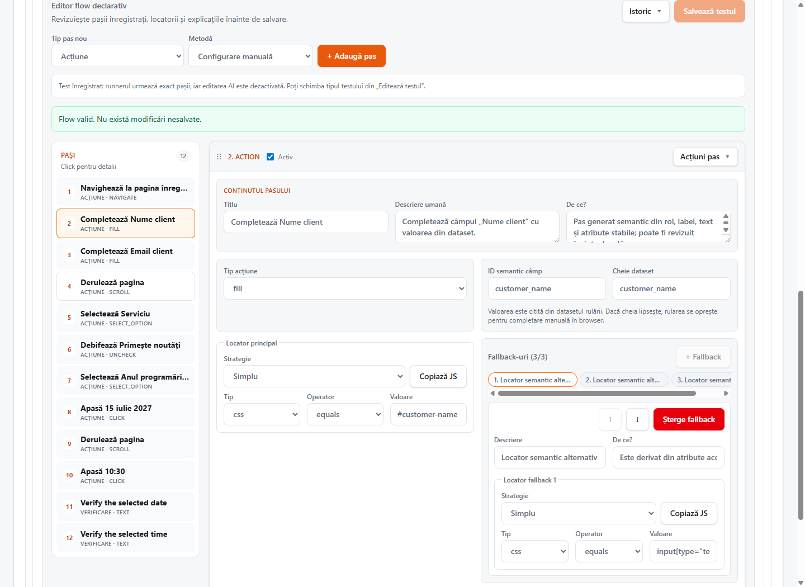
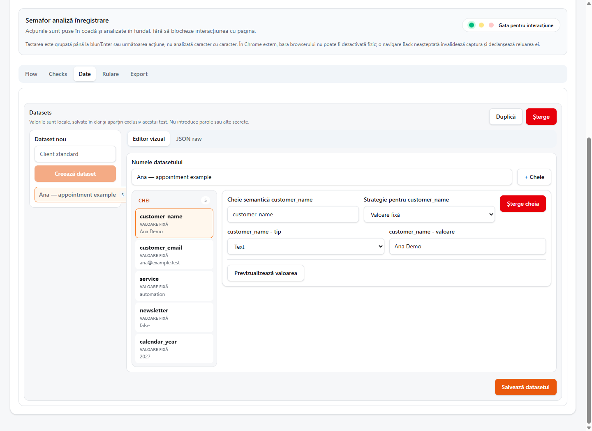
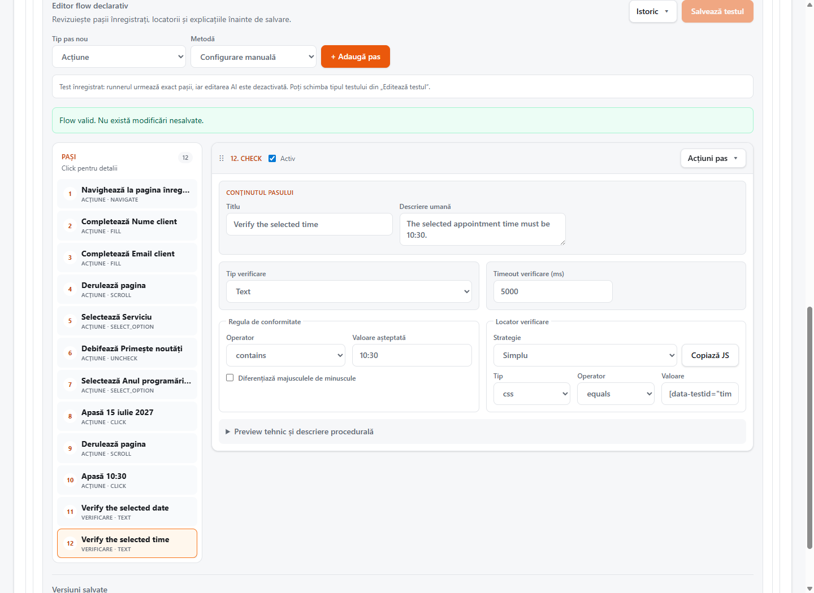
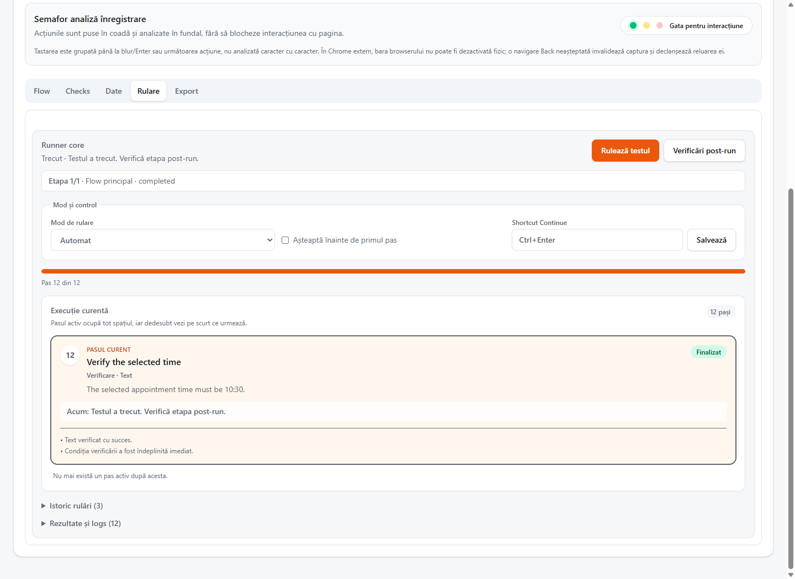
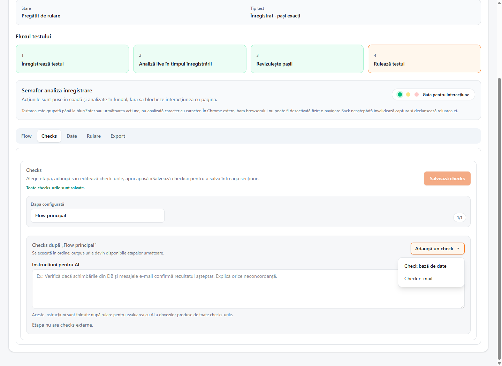
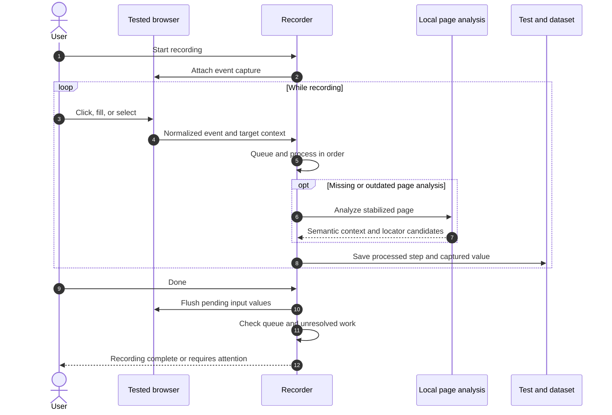
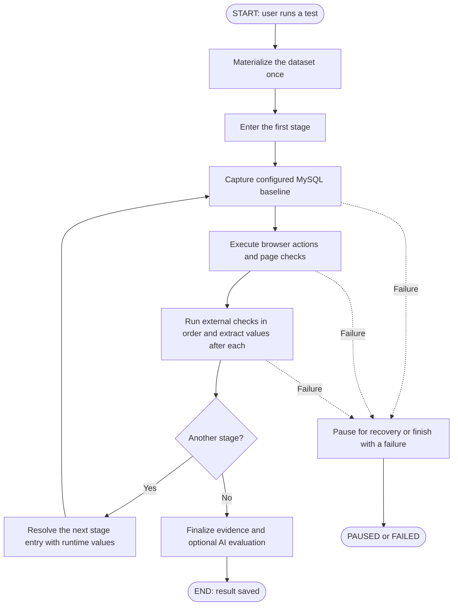
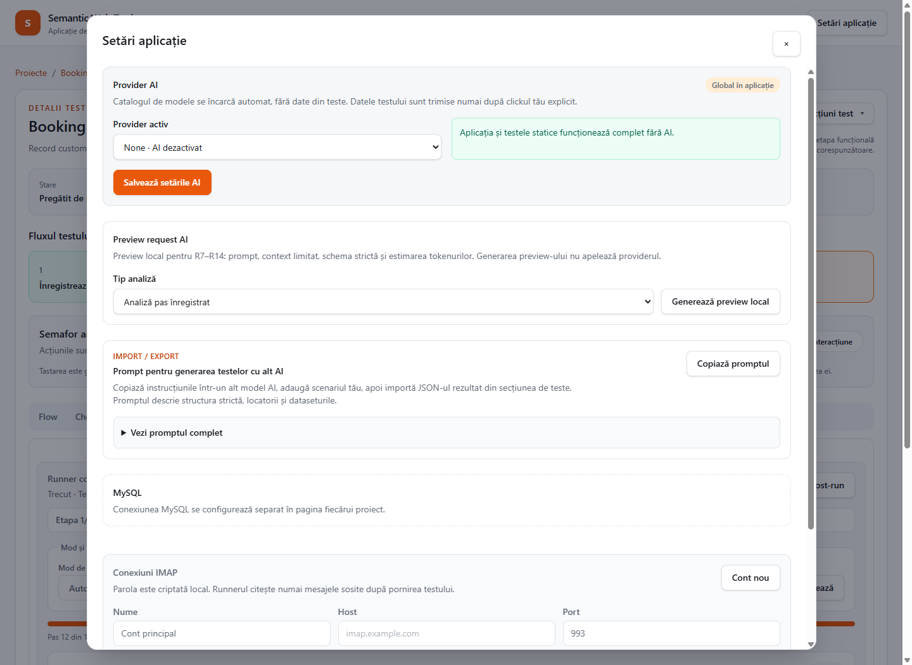
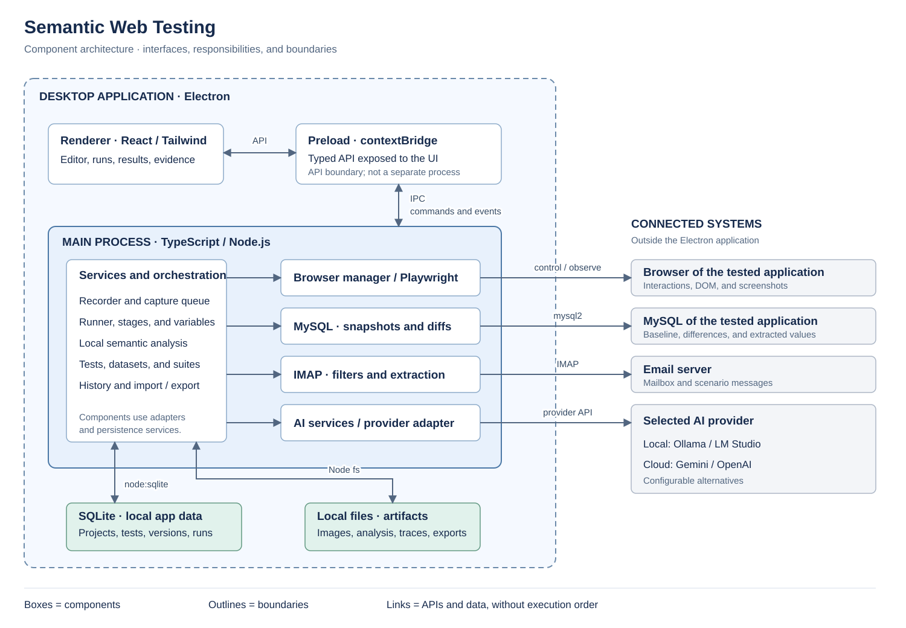

# Semantic Web Testing

**Record a web journey. Check the page, the database, and the confirmation email.**

A desktop testing workspace built with **Electron, React, TypeScript, and Playwright**. Create readable tests from browser interactions, reuse them with different datasets, and inspect what happened across the browser, MySQL, and IMAP. Optional AI features help with test authoring, visual checks, and evaluating collected evidence.



_A real recording in the application. The interface currently uses Romanian labels; this guide includes those labels alongside their English meaning._

[Try it locally](#try-it-locally) · [Walkthrough](#walkthrough-a-booking-form) · [How it works](#how-it-works) · [Architecture](#architecture) · [Repository guide](#repository-guide) · [Development](#development-and-verification)

## Why this project exists

A successful click is only one part of a business process. A booking can look correct on screen while the database contains the wrong appointment or the customer never receives a confirmation.

This project was built to bring **browser + database + email verification** into one workflow. It gives QA engineers and developers a place to record the interaction, define the expected outcome, and inspect the evidence when something goes wrong.

| Surface | Question                                        | Evidence                                                          |
| ------- | ----------------------------------------------- | ----------------------------------------------------------------- |
| Browser | Did the user select the expected date and time? | Element, text, URL, JavaScript, or visual checks                  |
| MySQL   | What records changed after the interaction?     | Before/after snapshots, row differences, extracted values         |
| Email   | Did a matching confirmation arrive?             | New IMAP messages filtered by sender, recipient, subject, or body |

Collecting a database diff is separate from proving a business rule. The test must specify the relevant filters, required extracted values, or an explicit AI evaluation prompt.

## What you can do

- **Record and edit:** turn browser actions into an ordered flow with descriptions, targets, fallback locators, and waits.
- **Separate data from behavior:** reuse the same flow with named datasets; generate values or request manual input where needed.
- **Check multiple systems:** combine page assertions with MySQL and IMAP checks after each stage.
- **Continue across stages:** extract an ID or URL from a database row or email and use it in a later stage of the same run.
- **Debug interactively:** run automatically, stop at breakpoints, advance step by step, or insert a manual intervention.
- **Review evidence:** inspect step results, screenshots, available traces, execution history, and AI usage.
- **Organize and share:** group tests into suites, run selected tests in sequence, and import/export JSON definitions.

Ordinary recorded actions and DOM assertions work with **AI disabled**. MySQL, IMAP, and AI are optional integrations.

## Try it locally

The walkthrough was verified on **Windows with Node.js 24 and installed Google Chrome**. You also need npm. `playwright-core` does not download browser binaries during installation; choose an installed browser in the application.

```bash
npm install
```

Start the included booking playground in one terminal:

```bash
npm run fixture:web
```

Start the desktop application in another:

```bash
npm run electron:start
```

The playground runs at **http://127.0.0.1:4173/**. The port is fixed, so it must be available. The browser walkthrough below needs only these two processes; MySQL and email setup are covered in the [integration guide](docs/INTEGRATIONS.md).

For development with the renderer development server, use `npm run dev` instead of `npm run electron:start`.

## Walkthrough: a booking form

This example prepares a booking and verifies the selected date and time. It does **not submit the form**. The screenshots use an isolated local profile and synthetic data.

### 1. Create a project and record the interaction

Create a project named **Booking Lab** with the playground URL above. Open its browser, choose an installed Chrome instance with a temporary session, and create a recorded test named **Booking — browser walkthrough**.

Start recording, then interact with the playground:

| Form control                        | Demo value           |
| ----------------------------------- | -------------------- |
| Nume client — customer name         | `Ana Demo`           |
| Email                               | `ana@example.test`   |
| Serviciu — service                  | Automatizare browser |
| Primește noutăți — newsletter       | Unchecked            |
| Anul programării — appointment year | `2027`               |
| Calendar day                        | July 15              |
| Time slot                           | `10:30`              |

Stop with **Done** after the recorder has finished processing its queue. The demonstrated recording produced ten actions, including navigation and scrolling. Your count can vary with the interactions needed to reach each control.

In **Flow**, inspect the result. Each step exposes its action, target, fallback locators, and explanation. A fill action refers to a dataset key instead of embedding the customer's name in the action definition.

### 2. Review the reusable data

Open **Date** — Data — to inspect the values captured during recording. The demo dataset, **Ana — appointment example**, contains the customer's name, email, service, newsletter choice, and year.



To test another customer, create another dataset and keep the same flow. Calendar and time clicks remain specific targets unless you explicitly parameterize or edit them; changing the name alone does not change the appointment selection.

### 3. Define what success means

In **Flow**, select **Verificare** — Check — as the new step type and choose **+ Adaugă pas**. Add two text checks:

| Check                    | CSS target                           | Condition             |
| ------------------------ | ------------------------------------ | --------------------- |
| Verify the selected date | `[data-testid="calendar-selection"]` | Contains `2027-07-15` |
| Verify the selected time | `[data-testid="time-selection"]`     | Contains `10:30`      |



These assertions turn a replay into a test: clicking a time is an action; verifying the displayed selection establishes the expected result. Save the flow and test using **Salvează flow-urile** / **Salvează testul** where shown.

### 4. Run and inspect the result

Open **Rulare** — Run — select **Automat**, choose the dataset, and click **Rulează testul**. If prompted, open the project's browser first. Leave the optional MySQL, IMAP, and AI post-run features disabled for this example.



The captured run completed with **12 passing steps: 10 recorded actions and 2 text checks**. Results and logs are available below the current step. **Verificări post-run** opens the evidence summary.

To exercise a failure deliberately, change the expected time to `11:00`, save, and rerun. The final check should fail against the unchanged `10:30` selection. Restore the expectation afterwards.

### 5. Extend it to database and email verification

The **Checks** tab adds external checks to the current stage. Configure MySQL for the project and an IMAP account in **Setări aplicație** — Application settings — before enabling them.



For a full submission against the bundled fixture, follow the [MySQL and email tutorial](docs/INTEGRATIONS.md). It uses the fixture's supported **Testare semantică** service and seeded availability. The browser-only screenshots above do not demonstrate a database write or email delivery.

## How it works

### From browser interaction to an editable test

“Semantic” means that a target can carry context such as its accessible role, label, text, or relationship to a repeated component. The stored test still exposes concrete locator strategies for inspection and editing.

The sequence starts when the user presses record. Browser actions go to the recorder; analysis produces context for building the saved steps.



Input is grouped into completed edits rather than one step per keystroke. Recording can continue while the queue is being processed; errors pause processing for review. Existing page analysis can be reused until relevant navigation changes its context.

### Step types and their purpose

| Family                           | Examples                                                            | Purpose                                                         |
| -------------------------------- | ------------------------------------------------------------------- | --------------------------------------------------------------- |
| Browser action                   | Navigate, hover, click, fill, upload, select, checkbox, key, scroll | Reproduce the user's interaction                                |
| Synchronization                  | Wait for element or URL; configured wait after an action            | Advance when the expected state is available                    |
| Structured target action         | Repeated item or calendar selection                                 | Click the intended item using its configured target and context |
| Page check                       | Element state, text, URL, JavaScript                                | Assert an explicit condition                                    |
| Visual / adaptive check          | Screenshot prompt; DOM-first check with optional visual fallback    | Evaluate a condition that needs visual context                  |
| Visual AI action                 | AI-directed clicks within a viewport or selected region             | Interact using image coordinates when configured                |
| External check                   | MySQL snapshot diff; matching IMAP messages                         | Collect evidence and optionally extract runtime values          |
| Breakpoint / manual intervention | Pause for inspection or a described human action                    | Keep the user in control of exceptional steps                   |

A checkbox action named `check` changes an input. A step of type `check` verifies a condition. Calendar actions use configured targets; they are not a universal calendar interpreter.

### Stages connect the evidence

Each stage has an entry rule, a browser flow, and ordered external checks. The diagram shows a configured stage with a MySQL baseline; disabled integrations are skipped. It has one starting point and explicit completion/failure paths.



For example, a custom application could create a booking in stage 1, expose its confirmation URL in an email, and open that extracted URL in stage 2. The browser session and materialized dataset are shared across the stages. This is an extension pattern; the included fixture does not implement that entire confirmation-link journey.

### Why these implementation choices matter

| Choice                                                | Practical benefit                                                                                                                                         |
| ----------------------------------------------------- | --------------------------------------------------------------------------------------------------------------------------------------------------------- |
| Declarative flows with separate datasets              | The same behavior can be reviewed and reused with different inputs.                                                                                       |
| Semantic context plus explicit locators and fallbacks | Targets remain understandable, and failed resolution has something concrete to inspect. Ambiguous matches are not silently accepted as the first element. |
| Serialized recording queue                            | Event processing preserves order while the user continues interacting.                                                                                    |
| A baseline for each configured stage                  | Database differences can be inspected in the context of that stage's actions.                                                                             |
| Runtime variables with recorded origins               | A later action can use an earlier result and retain information about where it came from.                                                                 |
| Local persistence and optional AI providers           | Ordinary recorded tests can run without a cloud model.                                                                                                    |

### Where AI fits

AI is used in separate, explicit roles: authoring or adapting a test plan, visual assertions and visual actions, and optional post-run evaluation. Providers include **Ollama, LM Studio, Gemini, and OpenAI**, plus **None**.

<details>
<summary>AI and connection settings in the application</summary>



</details>

Post-run evaluation currently receives the dataset and MySQL/IMAP evidence. Browser screenshots are evaluated by visual checks in the flow; they are not automatically included in that same post-run request. An AI verdict depends on the evidence, prompt, and model and should be reviewed accordingly.

## Architecture

This is a **component diagram**: boxes describe responsibilities and boundaries; links describe interfaces and data access. It has no execution starting point. Runtime order is shown above.



| Layer                          | Implementation                                        |
| ------------------------------ | ----------------------------------------------------- |
| Desktop UI                     | React, Tailwind CSS, Vite                             |
| Desktop services               | Electron main process and TypeScript                  |
| UI-to-main boundary            | Typed API exposed through preload and `contextBridge` |
| Browser automation             | Playwright via `playwright-core`                      |
| Application persistence        | Local SQLite via `node:sqlite`, plus artifact files   |
| System-under-test integrations | `mysql2`, `imapflow`, `mailparser`                    |
| Optional fixture email sender  | `nodemailer` using separately configured SMTP         |
| Automated checks               | Vitest and Testing Library                            |

**SQLite stores the testing tool's own data. MySQL is the database of the application being tested.**

## Development and verification

```bash
npm run format:check
npm run lint
npm run typecheck
npm test
npm run build
npm run fixture:web:build
```

`npm run verify` runs those checks in order. For a browser recorder smoke test, start `npm run fixture:web`, then run:

```bash
npm run smoke:recorder
```

The smoke script defaults to the Windows Chrome installation path. Set `SEMANTIC_CHROME_PATH` when Chrome is elsewhere. `npm run smoke:mysql` is a separate integration check requiring the [local MySQL fixture](docs/INTEGRATIONS.md); it clears fixture booking data.

Verification on **9 October 2026**: `npm run verify` passed, including **500 tests across 88 files**, formatting, lint, TypeScript checks, the application build, and the web-fixture build. The documentation walkthrough also includes a passing recorder smoke check and the **12-step browser run** pictured above. Live MySQL, IMAP, and external AI-provider calls were not exercised during this documentation pass.

## Repository guide

The project is organized by responsibility. Tests live beside the code they verify as `*.test.ts`, `*.test.tsx`, or `*.test.mjs`; there is no separate top-level test directory.

### Application code

| Folder or file                                         | What you will find here                                                                                                                                                        |
| ------------------------------------------------------ | ------------------------------------------------------------------------------------------------------------------------------------------------------------------------------ |
| [`src/main/`](src/main/)                               | Electron startup and application services for projects, tests, datasets, suites, imports/exports, settings, and run history. These services perform operations outside the UI. |
| [`src/main/browser/`](src/main/browser/)               | Browser discovery, launching, session management, and the Playwright adapter.                                                                                                  |
| [`src/main/recorder/`](src/main/recorder/)             | Capture of browser events, the recording queue, and conversion of interactions into editable steps.                                                                            |
| [`src/main/page-analysis/`](src/main/page-analysis/)   | DOM capture, semantic analysis, locator candidates, and comparison of page versions.                                                                                           |
| [`src/main/runner/`](src/main/runner/)                 | Test execution, target resolution, waits, dataset values, stage transitions, and extraction of runtime variables.                                                              |
| [`src/main/mysql/`](src/main/mysql/)                   | MySQL connections, schema access, snapshots, row differences, and cleanup of selected inserted rows.                                                                           |
| [`src/main/imap-service.ts`](src/main/imap-service.ts) | Email account handling, message collection, and filtering. IMAP is implemented as a service file directly under `main`.                                                        |
| [`src/main/ai/`](src/main/ai/)                         | AI provider adapters, prompt/output handling, assisted test creation and editing, and post-run evaluation.                                                                     |
| [`src/main/persistence/`](src/main/persistence/)       | Local SQLite initialization, migrations, and repositories that store application data.                                                                                         |
| [`src/preload/`](src/preload/)                         | The typed API exposed to the renderer through Electron's `contextBridge`.                                                                                                      |
| [`src/renderer/`](src/renderer/)                       | React screens, editors, settings dialogs, evidence views, and application styles.                                                                                              |
| [`src/renderer/components/`](src/renderer/components/) | Shared UI controls such as buttons, inputs, tabs, modals, and status badges.                                                                                                   |
| [`src/shared/`](src/shared/)                           | Data models, validation, and IPC contracts shared by the main process and UI.                                                                                                  |

### Demo, documentation, and tooling

| Folder                                               | What you will find here                                                                                       |
| ---------------------------------------------------- | ------------------------------------------------------------------------------------------------------------- |
| [`fixtures/web/`](fixtures/web/)                     | The local booking playground used to record and replay browser scenarios.                                     |
| [`fixtures/mysql/`](fixtures/mysql/)                 | The playground's database schema, booking persistence, and database fixture tests.                            |
| [`fixtures/mail/`](fixtures/mail/)                   | Optional SMTP configuration and confirmation-email generation for the playground.                             |
| [`fixtures/default-files/`](fixtures/default-files/) | Synthetic PDF, DOCX, XLSX, image, ZIP, and text files used by upload steps. These are functional test assets. |
| [`schemas/`](schemas/)                               | JSON schemas describing test and dataset interchange formats.                                                 |
| [`scripts/`](scripts/)                               | Development launchers, fixture setup/server helpers, and browser/database smoke checks.                       |
| [`docs/`](docs/)                                     | The integration tutorial and detailed product behavior reference.                                             |
| [`docs/assets/`](docs/assets/)                       | The real application screenshots and English component diagram used in this README.                           |
| [`docs/diagrams/`](docs/diagrams/)                   | Architecture illustrations referenced by the detailed Romanian product guide.                                 |

### Root configuration

| File                                                                            | Purpose                                                                                                              |
| ------------------------------------------------------------------------------- | -------------------------------------------------------------------------------------------------------------------- |
| [`package.json`](package.json)                                                  | Application metadata, dependencies, and npm commands.                                                                |
| [`package-lock.json`](package-lock.json)                                        | The dependency lockfile. npm is the package manager used by this project's setup and verification workflow.          |
| [`tsconfig.json`](tsconfig.json) / [`tsconfig.build.json`](tsconfig.build.json) | TypeScript checking and build configuration.                                                                         |
| [`vite.config.ts`](vite.config.ts)                                              | Renderer bundling and development-server configuration.                                                              |
| [`vitest.config.ts`](vitest.config.ts)                                          | Discovers tests only in `src/` and `fixtures/`, keeping temporary copies and generated output out of the test suite. |
| [`eslint.config.js`](eslint.config.js) / [`.prettierrc.json`](.prettierrc.json) | Lint and formatting rules.                                                                                           |
| [`.editorconfig`](.editorconfig) / [`.gitattributes`](.gitattributes)           | Editor defaults and consistent line endings.                                                                         |
| [`.gitignore`](.gitignore) / [`.prettierignore`](.prettierignore)               | Files excluded from version control or formatting.                                                                   |
| [`.env.fixture.example`](.env.fixture.example)                                  | Empty SMTP configuration template; copy to the ignored `.env.fixture` file for local credentials.                    |

Local folders such as `node_modules/` (installed dependencies), `dist/` (build output), `runtime/` (fixture process files and logs), and `tmp/` (scratch work) are generated or local-only and are ignored by Git. The application's own SQLite database and run artifacts use its configured local data directory.

Start reading the implementation at the [test model](src/shared/test-model.ts), [recorder](src/main/recorder/recorder-service.ts), [runner](src/main/runner/test-runner-service.ts), [step executor](src/main/runner/step-executor.ts), or [IPC contract](src/shared/ipc.ts).

## Current scope

This is an actively developed desktop project. The walkthrough is verified on Windows; cross-platform packaging and a headless CI runner are not demonstrated here. The UI is currently in Romanian.

IMAP checks wait for matching new messages and can require manual abandonment if no match arrives. They do not currently prove that an email will never arrive. MySQL cleanup can remove selected inserted rows; it is not a general rollback of updates and deletes.

Use synthetic datasets for shared demos. Connection secrets use Electron's local secure-storage facilities where available, while datasets, screenshots, emails, traces, and exports can contain the application data used in a test. Review those artifacts before sharing them, and review the context supplied to an enabled AI provider.

More detail: [integration tutorial](docs/INTEGRATIONS.md) · [detailed product behavior, in Romanian](docs/PRODUCT_LOGIC_REVIEW.ro.md).

## License

Released under the [MIT License](LICENSE).
