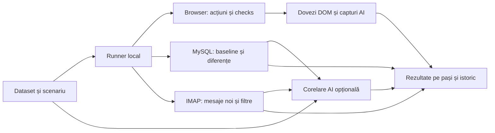
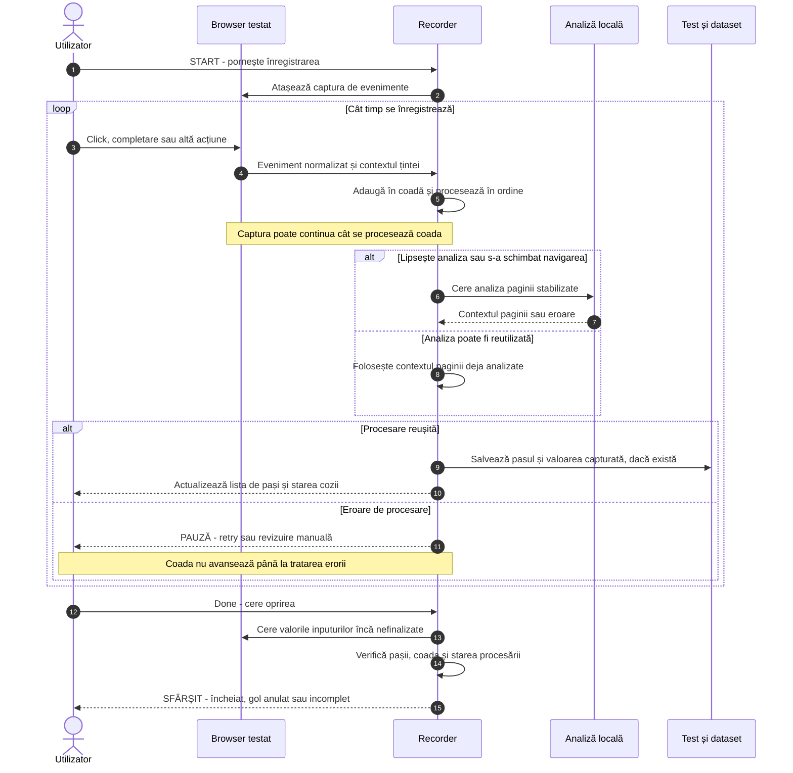
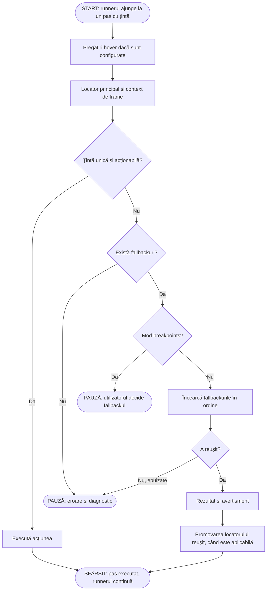
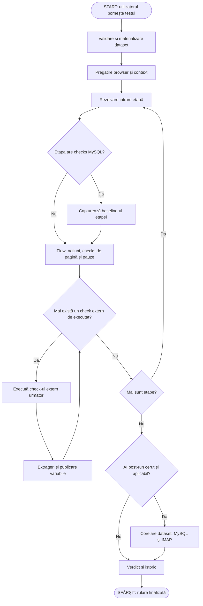
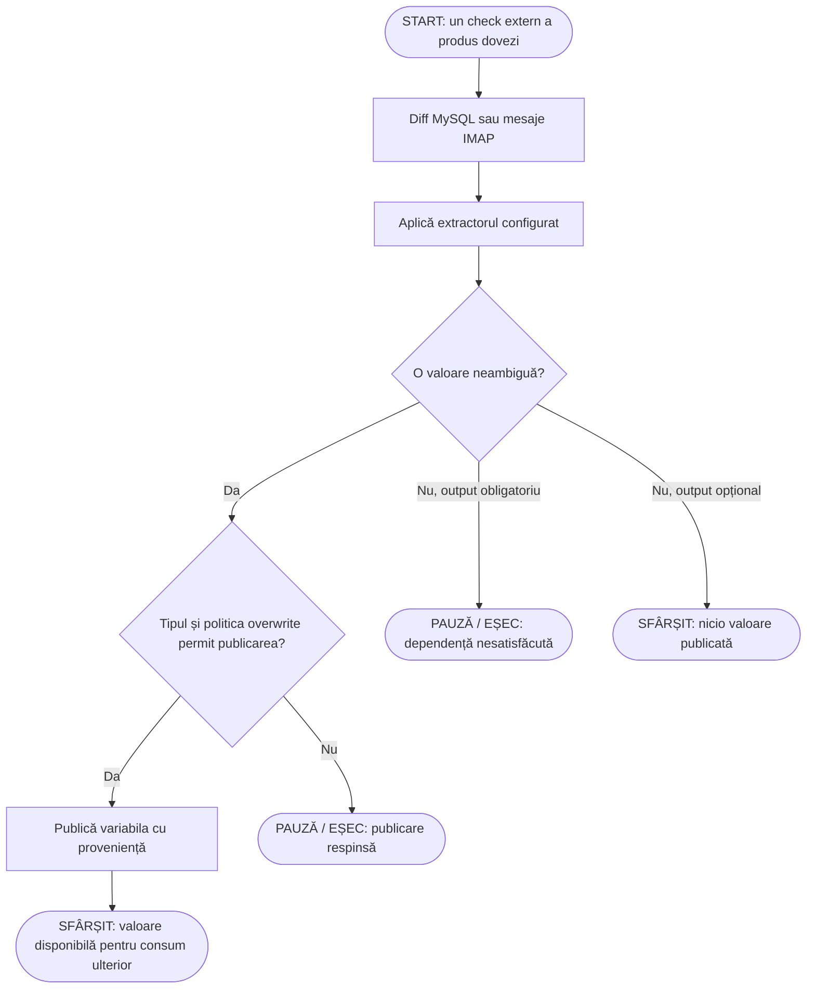
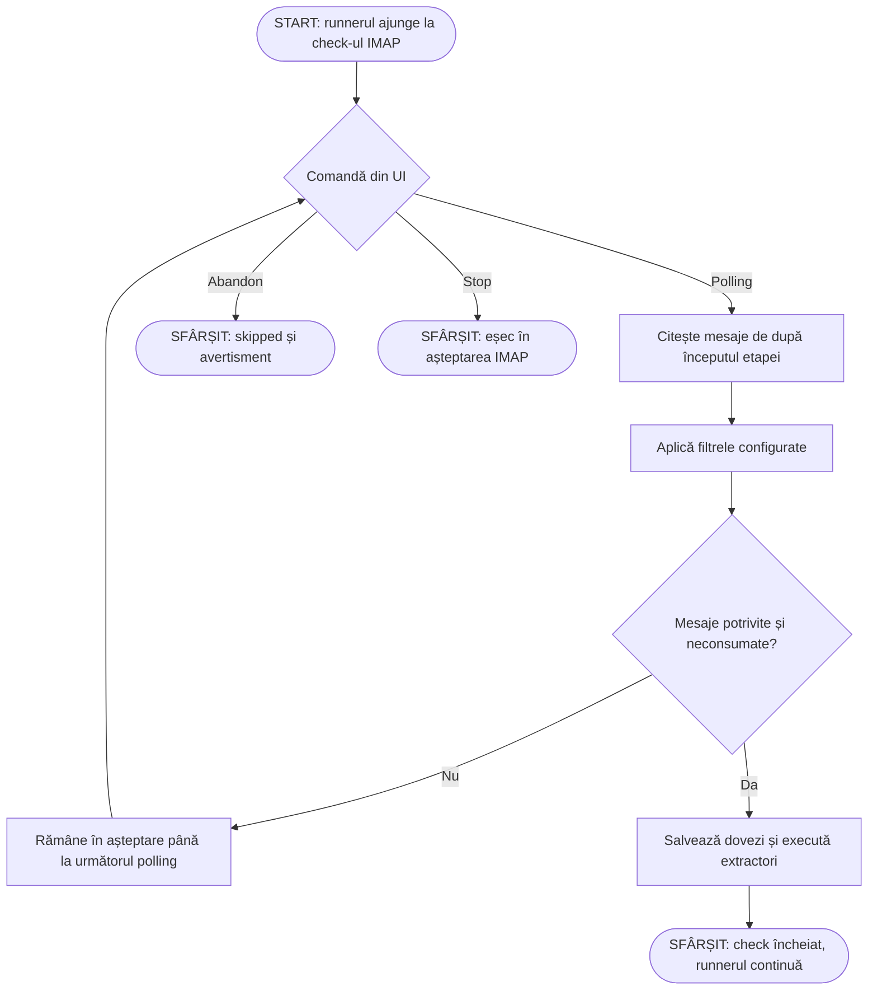
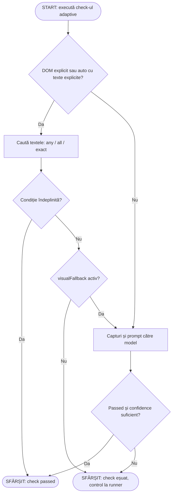
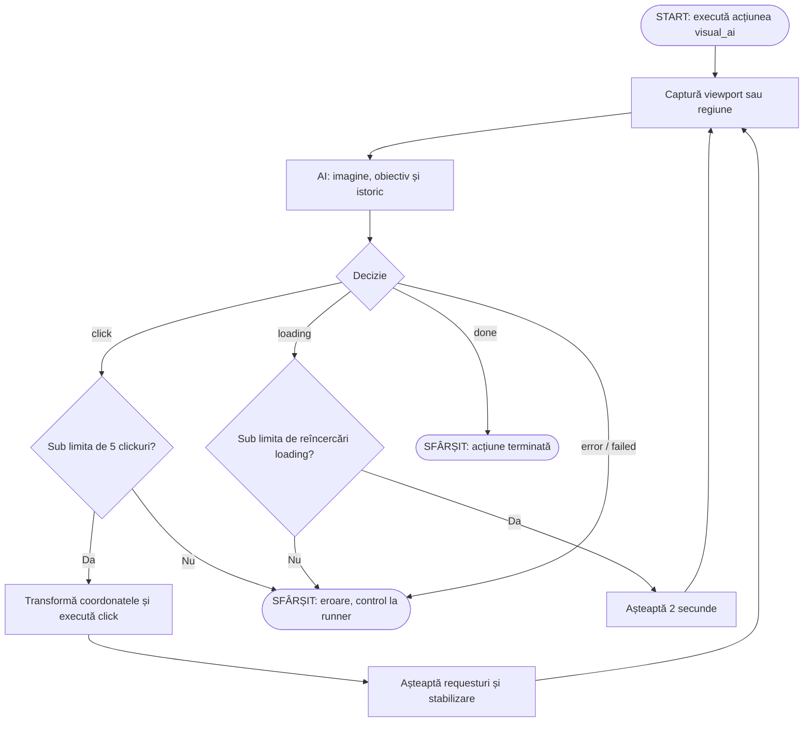
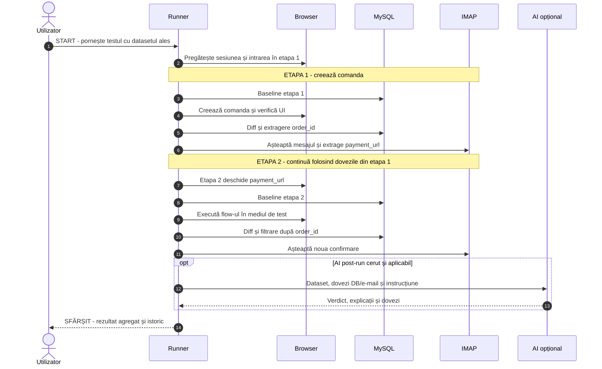
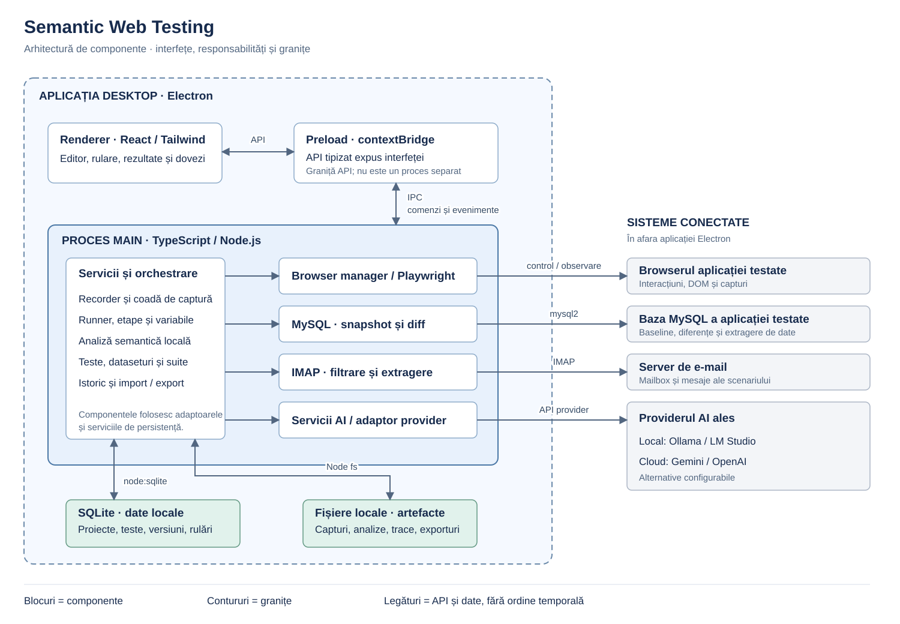

# Semantic Web Testing — hartă de produs și logică

Documentație tehnică despre modelul aplicației, logica pașilor, integrări, diagrame și limitele implementării.

**Analiză:** 8–9 octombrie 2026. **Baza:** codul sursă, explorarea interfeței și verificările automate și de browser descrise mai jos.

**Motivație confirmată de autor:** verificarea completă a unui proces prin **browser + MySQL + e-mail**.

Nivelurile de certitudine folosite în document:

- **Confirmat:** comportament urmărit în cod sau interfață. Nu înseamnă că fiecare integrare a fost exercitată live.
- **Raționament dedus:** explicația tehnică dedusă pentru o alegere; autorul o poate corecta.
- **De validat:** intenție, limită sau comportament care necesită o decizie ori o demonstrație suplimentară.

Verificările vizuale folosesc interpretarea capturilor de ecran de către un model multimodal.

### Cum se citesc diagramele

- **Procesele (3–8):** încep în nodul `START`, se citesc de sus în jos și se termină într-un nod `SFÂRȘIT` sau `PAUZĂ`. Săgețile de întoarcere indică o reîncercare; etichetele explică alegerea ramurii.
- **Secvențele (2 și 9):** se citesc de sus în jos, în ordinea mesajelor numerotate. Coloanele arată participanții, iar săgețile arată cine trimite către cine. Prima coloană nu înseamnă primul pas.
- **Harta dovezilor (1) și arhitectura (10):** arată relații între date sau componente. Nu au un „prim pas” de execuție. Ordinea rulării este în diagrama 4.

## 1. Problema și identitatea produsului

Un proces poate arăta corect în interfață, dar să salveze date greșite sau să trimită un e-mail incomplet. Aplicația oferă un spațiu comun pentru executarea acțiunilor și inspectarea efectelor în aceste trei suprafețe.

Utilizatorul înregistrează sau construiește un scenariu, separă datele de acțiuni, adaugă verificări și urmărește execuția. AI poate ajuta la construcția testului, la interpretarea imaginii și la corelarea rezultatelor MySQL/IMAP cu datele folosite.

**Public țintă:** instrument desktop pentru QA și dezvoltatori, destinat verificării unor procese web complete și depanării lor dintr-o interfață vizuală.

### Diagrama 1 — cele trei suprafețe de verificare

**Tip:** hartă a dovezilor. Urmărește legăturile de la dataset/scenariu către sursele de dovezi și rezultat; ramurile nu afirmă că browserul, MySQL și IMAP rulează simultan.

**Distincție:** evaluarea AI post-run primește în prezent dovezile MySQL/IMAP și datasetul. Capturile sunt evaluate de checks vizuale din flow; nu intră automat în același request post-run.

## 2. Modelul aplicației

| Concept           | Rol și relație                                                                       |
| ----------------- | ------------------------------------------------------------------------------------ |
| Proiect           | Aplicația testată: nume, URL, browser, sesiune și setări MySQL/Basic Auth.           |
| Pagină analizată  | Captura structurii, elementelor, formularelor și contextului semantic; are versiuni. |
| Test              | Scenariul persistent, versiunea, tipul său, dataseturile și una sau mai multe etape. |
| Etapă / stage     | Regula de intrare, un flow de browser și checks externe ordonate.                    |
| Flow              | Acțiuni, verificări în pagină, breakpointuri și intervenții manuale, în ordine.      |
| Dataset           | Valorile de intrare ale unui test, independente de pașii care le consumă.            |
| Variabilă runtime | Valoare produsă în rulare, cu tip, sursă, etapă și producător.                       |
| Run               | O execuție concretă: date materializate, stări, rezultate, dovezi și consum AI.      |
| Suită             | Listă ordonată de teste, cu dataseturi și reguli de sesiune/reîncercare.             |
| Batch run         | Execuția unei suite sau selecții de teste, cu rezultate agregate.                    |

**SQLite** stochează local datele instrumentului. **MySQL** este baza aplicației testate, conectată pentru verificări.

### Dimensiuni independente

| Dimensiune                 | Valori                                                                              | Semnificație                                                 |
| -------------------------- | ----------------------------------------------------------------------------------- | ------------------------------------------------------------ |
| Tip test                   | `recorded`, `dynamic_ai`                                                            | Pași înregistrați sau editare/adaptare asistată de AI.       |
| Mod execuție               | `automatic`, `breakpoints`, `step_by_step`                                          | Cum controlează utilizatorul avansarea.                      |
| Workflow                   | `not_recorded`, `recording`, `recorded`, `analyzing_flow`, `flow_analyzed`, `ready` | Progresul pregătirii testului, inclusiv stările tranzitorii. |
| Validitate                 | `draft`, `valid`, `invalidated`                                                     | Starea definiției și a dependențelor sale.                   |
| Stare runner / verdict run | De exemplu running, waiting, completed / passed, failed                             | Ce face motorul acum, respectiv cum s-a încheiat execuția.   |

Un test înregistrat poate conține checks vizuale explicite. Dependența de AI vine și din pași/opțiuni, nu doar din tipul testului. Interfața tratează și `dynamic_ai` ca necesitând configurare AI.

## 3. Înregistrarea și analiza semantică

### Diagrama 2 — cine primește acțiunea și cum ajunge în test

**Tip:** diagramă de secvență. **Primul pas:** utilizatorul pornește înregistrarea. Urmează mesajele numerotate de sus în jos.

**Exemplu:** scrii „Ana” într-un câmp și ieși din el. Browserul trimite un eveniment `fill`, recorderul îl pune în coadă, obține sau reutilizează contextul paginii și salvează pasul plus valoarea în dataset. Următorul click produce un eveniment nou pe același traseu. Coada permite capturarea mai multor evenimente în timp ce procesarea lor rămâne serială.

`Done` este o comandă separată, nu o acțiune a aplicației testate. Finalizarea reușită cere pași salvați, coadă goală și lipsa unui pas sau a unei erori nerezolvate. Înregistrarea goală se anulează; oprirea cu lucru nerezolvat se marchează incompletă. După o eroare, `retry` reintroduce evenimentul la începutul cozii; ignorarea explicită a analizei deschide un preview manual, de unde pasul poate fi adăugat sau abandonat.

**Confirmat:**

- Tastarea este grupată și salvată la finalizarea inputului, precum blur/Enter; nu se creează un pas pentru fiecare caracter.
- `Tab` mută focusul și poate finaliza valoarea unui input, fără să devină automat un pas de tastă separat.
- Evenimentele interne recorderului sunt ignorate; unele scrolluri consecutive sunt comasate.
- Se păstrează navigarea inițială. Un click urmat de navigare poate fi comasat cu așteptarea URL-ului rezultat.
- Evenimentele sunt procesate dintr-o coadă. Analiza paginii poate fi reutilizată când generația navigării nu s-a schimbat.
- Valorile capturate ajung în datasetul „Înregistrare recorder”.
- Continuarea înregistrării poate reda flow-ul existent înainte de reluarea capturii; replay-ul `flowOnly` omite checks și nu certifică scenariul complet.

Analiza locală identifică roluri, nume accesibile, etichete, atribute, formulare, componente repetitive, calendare și sloturi. Produce referințe semantice și locatori candidați, cu estimări de stabilitate.

Compararea versiunilor paginii normalizează anumite valori volatile, precum ID-uri dinamice și tokenuri. Schimbările relevante pot invalida testele dependente. Runnerul poate executa un test invalidat cu avertisment; invalidarea nu este un eșec observat la rulare.

**Raționament dedus:** înregistrarea oferă un punct de pornire concret; normalizarea reduce zgomotul; explicațiile și locatorii editabili păstrează scenariul inspectabil.

**De reconciliat:** unele texte UI spun „analiză după fiecare acțiune” sau „pagina este blocată”, în timp ce implementarea folosește coadă și reutilizarea analizei. Prezentarea publică trebuie să descrie comportamentul demonstrat.

Surse: [recorder](../src/main/recorder/recorder-service.ts), [captura evenimentelor](../src/main/recorder/recorder-browser-capture.ts), [analizor semantic](../src/main/page-analysis/semantic-analyzer.ts), [detector de schimbări](../src/main/page-analysis/semantic-change-detector.ts).

## 4. Catalogul pașilor

### 4.1. Cele patru familii de elemente din flow

| Familie               | Ce face                                                 | Motiv tehnic dedus                        |
| --------------------- | ------------------------------------------------------- | ----------------------------------------- |
| `action`              | Modifică pagina sau sincronizează execuția.             | Reproduce interacțiunea utilizatorului.   |
| `check`               | Evaluează o condiție sau colectează dovezi externe.     | Stabilește ce rezultat trebuie verificat. |
| `breakpoint`          | Pune execuția în pauză, cu context despre pașii vecini. | Permite inspecție și depanare controlată. |
| `manual_intervention` | Cere intervenția descrisă și așteaptă Continue.         | Acoperă etape care cer control uman.      |

### 4.2. Acțiunile

| `actionType`                               | Comportament implementat                                                                               | Exemplu și motiv                                                             |
| ------------------------------------------ | ------------------------------------------------------------------------------------------------------ | ---------------------------------------------------------------------------- |
| `navigate`                                 | Deschide URL-ul și așteaptă `domcontentloaded`; runnerul rezolvă templateurile URL.                    | Deschide formularul ori linkul dintr-o etapă anterioară.                     |
| `hover`                                    | Localizează ținta și mută pointerul peste ea.                                                          | Deschide un meniu care apare la hover.                                       |
| `click`                                    | Rezolvă o țintă unică și acționabilă, apoi execută click. Acceptă repetare și `repeatUntil`.           | Apasă Trimite; avansează lunile unui calendar până la un marker.             |
| `fill`                                     | Completează inputul din `valueKey` în dataset. Datele absente/manuale declanșează colectarea asistată. | Completează numele fără a-l fixa în definiția acțiunii.                      |
| `upload_file`                              | Folosește `setInputFiles` cu o cale din dataset.                                                       | Încarcă un document de test.                                                 |
| `select_option`                            | Încearcă valoarea opțiunii, apoi eticheta vizibilă.                                                    | Acceptă valori din recorder și etichete furnizate în importuri.              |
| `check`                                    | Bifează; dacă există valoare de dataset, starea booleană poate determina debifarea.                    | Același pas urmează un dataset cu acord bifat sau nebifat.                   |
| `uncheck`                                  | Debifează; dacă există valoare de dataset adevărată, poate bifa.                                       | Cu dataset, starea solicitată are prioritate față de numele acțiunii.        |
| `press_key`                                | Trimite tasta către țintă sau tastatura paginii.                                                       | Enter într-un input, Escape pentru un meniu.                                 |
| `scroll`                                   | Scroll în pagină/container prin DOM sau wheel, cu delte X/Y.                                           | Ajunge la o zonă ascunsă ori reproduce un control sensibil la wheel.         |
| `wait_for_element`                         | Așteaptă localizarea și vizibilitatea țintei.                                                          | Sincronizează cu apariția unui control.                                      |
| `wait_for_url`                             | Așteaptă URL-ul configurat, după rezolvarea templateului.                                              | Confirmă sosirea pe pagina așteptată.                                        |
| `choose_repeated_item`                     | Execută mecanica de click asupra țintei alese prin locator, inclusiv unul de componentă repetitivă.    | Alege butonul din cardul produsului corect.                                  |
| `calendar_select`                          | Execută mecanica de click, cu repetare/condiție dacă este configurată.                                 | Alege o celulă identificată; nu este un interpret universal al calendarelor. |
| `visual_ai`                                | Capturează viewportul/regiunea; AI decide click/loading/done/error/failed.                             | Interacționează cu o zonă dificil de adresat prin DOM.                       |
| `manual_intervention` în enumul acțiunilor | Forma `action` este respinsă de executor ca nesuportată.                                               | Forma funcțională este `type: manual_intervention`, element separat de flow. |

Nu confundăm acțiunea `check` — bifare — cu familia `type: check`, care înseamnă verificare.

### 4.3. Verificările

| `checkType` | Intrare și logică                                                                                    | Ce demonstrează                                                                  |
| ----------- | ---------------------------------------------------------------------------------------------------- | -------------------------------------------------------------------------------- |
| `element`   | Locator și stare: visible/hidden/enabled/disabled/checked/unchecked. Absența poate satisface hidden. | Starea elementului.                                                              |
| `text`      | Textul țintei comparat prin equals/contains/keywords/prefix/sufix/regex.                             | Corespondența cu un text explicit.                                               |
| `url`       | URL-ul curent comparat cu operatorul configurat.                                                     | Destinația de navigare.                                                          |
| `js_eval`   | Evaluează un snippet în pagină; compară JSON sau interpretează `passed`/valoarea returnată.          | Condiția tehnică definită de autor.                                              |
| `visual`    | Prompt, capturi și prag de încredere; verdict AI.                                                    | Condiția vizibilă în imaginile trimise.                                          |
| `adaptive`  | Strategie DOM/visual/auto, texte așteptate și fallback vizual opțional.                              | Condiție textuală sau interpretare vizuală, după configurare.                    |
| `mysql`     | Baseline și snapshot curent pe tabele selectate; diff și extrageri opționale.                        | Schimbări observate și valori extrase; nu presupune singur o regulă de business. |
| `imap`      | Mesaje noi, cont/mailbox, filtre și extrageri opționale.                                             | Existența mesajelor potrivite și conținutul colectat.                            |

Checks de pagină rămân în flow. MySQL și IMAP se execută după flow-ul etapei. Există adaptare pentru testele vechi care le aveau în lista plată.

Checks DOM obișnuite reîncearcă o condiție încă neîndeplinită, implicit cu un buget configurat de 5 secunde și intervale de 200 ms. Durata efectivă poate include operațiile browserului. Ambiguitatea nu este rezolvată prin alegerea arbitrară a primului element.

Surse: [modelul pașilor](../src/shared/test-model.ts), [executor](../src/main/runner/step-executor.ts), [runner](../src/main/runner/test-runner-service.ts).

## 5. Cum este găsit elementul corect

Locatorii simpli sunt `css`, `role`, `label`, `text`, `title`, `placeholder` și `data_attribute`. Există și:

- `relative`: țintă față de o ancoră, prin inside/parent/ancestor/sibling/following/preceding;
- `repeated_component`: container, filtre ale conținutului și țintă din container;
- context de frame: pentru elemente din pagini încorporate;
- `revealBefore`: pregătiri prin hover care pot face vizibilă ținta.

Exemplu conceptual: „în cardul al cărui titlu conține Masaj Premium, apasă Rezervă”. Definiția păstrează relația dintre produs și buton.

### Diagrama 3 — localizare și recuperare

**Intrare:** un pas cu locator. **Ieșire:** pas executat, pauză pe eroare sau pauză pentru alegerea fallbackului. În modul `breakpoints`, diagrama se oprește la decizia utilizatorului: încercarea alternativelor este controlată manual, iar o alternativă reușită produce același rezultat și avertisment. Diagrama detaliază recuperarea dintr-o problemă de localizare; alte erori ale acțiunii sunt tratate de runner.

Fallbackul reușit poate deveni locator principal; cel vechi este păstrat ca alternativă. Este recuperarea printr-o alternativă cunoscută. Taskul AI `repair_locator` există ca schemă/prompt, dar nu trebuie prezentat ca reparare AI automată a oricărui test.

**De validat:** persistența promovării pentru testele cu `stages`; helperul modifică proiecția `flowItems`, deci trebuie demonstrată sincronizarea cu sursa pe etape.

Surse: [resolver](../src/main/runner/locator-resolver.ts), [auto-repair](../src/main/runner/locator-auto-repair.ts).

## 6. Logica rulării și a etapelor

### Diagrama 4 — ciclul principal

**Intrare:** comanda de pornire. **Ieșire:** verdictul rulării. Este traseul normal de execuție; pauzele și tratarea erorilor sunt detaliate în diagramele mecanismelor respective. Ramura „Nu” a deciziei despre checks acoperă și o etapă fără checks externe.

| Intrare etapă           | Comportament                                                    |
| ----------------------- | --------------------------------------------------------------- |
| `test_start`            | Prima etapă folosește contextul pregătit la începutul testului. |
| `continue_current_page` | Continuă din pagina curentă.                                    |
| `static_url`            | Navighează la URL-ul fix.                                       |
| `url_template`          | Construiește URL-ul folosind variabile.                         |
| `variable_url`          | Navighează la valoarea unei variabile de tip URL.               |

Aceeași sesiune de browser și același dataset materializat sunt păstrate între etape. Baseline-ul MySQL este specific etapei și se capturează **după navigarea de intrare, înaintea flow-ului**. Efectele produse chiar de navigarea de intrare nu sunt măsurate de acest interval.

Există așteptare înainte de pornire, breakpointuri, pauze după pași, intervenții manuale, date/variabile lipsă, fallbackuri și erori. Un breakpoint explicit este respectat și în modul automat.

### Sincronizare

- `waitAfter` poate cere none, dom_stable, network_idle, timeout, element sau URL.
- În implementarea actuală, `dom_stable` așteaptă `domcontentloaded`; nu garantează terminarea tuturor mutațiilor DOM.
- Smart Wait urmărește cererile document/fetch/XHR declanșate de acțiune, cu buget implicit de aproximativ 5 secunde și avertisment la depășire.
- `repeatUntil` verifică markerul înaintea clickului și limitează încercările; este util când luna inițială a calendarului poate varia.

**Raționament dedus:** stările explicite permit oprirea într-un punct explicabil și continuarea controlată. Așteptările bazate pe condiții reduc dependența de pauze fixe.

## 7. Dataseturi și variabile runtime

Dataseturile acceptă valori fixe, fișiere și generatoare: timestamp, UUID, număr aleator, e-mail unic, data curentă, dată relativă, alegere aleatoare și template cu tokenuri de generare. Se materializează o dată la pornirea run-ului.

Variabilele runtime acceptă string, number, boolean, URL, date_time și JSON. Păstrează proveniența, etapa, producătorul, momentul publicării, introducerea manuală și marcajul sensitive. Publicarea unui grup se validează înainte de adăugarea valorilor.

### Diagrama 5 — dovezi care alimentează etapa următoare

**Intrare:** dovezile unui singur check; MySQL și IMAP sunt surse alternative aici. **Ieșire:** o valoare publicată, un output opțional nepublicat sau o eroare. Un output opțional fără candidat unic este omis, inclusiv în caz de ambiguitate. Valoarea publicată poate fi consumată ulterior în URL-ul unei etape ori într-un filtru extractor MySQL. La pauză, opțiunile pot include retry al producătorului, introducere manuală sau stop.

**MySQL:** extractorul selectează tabela, sursa inserted/updated_before/updated_after/deleted/current_snapshot, filtrele și coloana. Cere exact un rând; două rânduri cu aceeași valoare rămân ambigue.

**IMAP:** extractorul poate alege un link după text/href, subiectul sau un grup regex din HTML/text. Valorile identice sunt deduplicate; rezultatul trebuie să fie unic.

Politica de suprascriere este deny sau replace. URL-urile sunt validate HTTP(S), fără credențiale. Componentele interpolate sunt codificate, cu tratament special pentru `baseUrl`.

**Limită actuală:** utilizările confirmate sunt intrările etapelor, URL-urile acțiunilor `navigate`/`wait_for_url` și filtrele extractorilor MySQL. `fill` citește `datasetValues`; nu presupunem că orice variabilă extrasă poate fi folosită în orice input, locator sau filtru IMAP. Templateul generat din dataset are propriul set limitat de tokenuri.

**De validat:** validarea statică verifică referințele unei etape înainte să înregistreze outputurile checks-urilor acelei etape. Consumul rezultatului unui check de către alt check din aceeași etapă trebuie demonstrat separat.

Surse: [etape și dependențe](../src/shared/test-stages.ts), [context variabile](../src/main/runner/session-variable-context.ts), [extractor MySQL](../src/main/runner/mysql-variable-extractor.ts), [extractor IMAP](../src/main/runner/imap-variable-extractor.ts).

## 8. MySQL: mecanism și semnificația rezultatului

1. Utilizatorul configurează conexiunea, tabelele și coloanele de identitate.
2. Înainte de flow-ul etapei se citește baseline-ul tabelelor selectate.
3. La check se citește starea curentă și se compară rândurile după identitate.
4. Rezultatul separă inserted, deleted și updated; actualizările păstrează before, after și coloanele schimbate. Identitățile duplicate sunt raportate separat.
5. Extractorii pot filtra rezultatul și publica valori. Difful poate fi inspectat sau trimis evaluatorului AI post-run.

**„MySQL check passed” înseamnă că au reușit captura, comparația și extragerile configurate.** Fără reguli suplimentare, un diff gol poate trece. Check-ul nu presupune implicit „trebuia creată o comandă”.

Un extractor obligatoriu din inserted, filtrat după datele scenariului, poate impune existența unui singur rând relevant. Reguli mai ample, precum concordanța comenzii și a e-mailului, pot fi evaluate prin instrucțiunea AI și dovezile disponibile sau inspectate de utilizator.

**Raționament dedus:** comparația before/after arată efectul operației, inclusiv actualizări și ștergeri omise de o simplă căutare a unui insert.

**Limite:** captura folosește `SELECT *` din tabelele selectate. Nu atribuie automat fiecare modificare exclusiv testului și nu este prezentată ca mecanism optimizat pentru tabele foarte mari ori trafic concurent. Filtrarea și corelarea datelor contează pentru atribuirea efectului scenariului.

### Cleanup

Cleanup-ul MySQL are selecție de rânduri inserate, preview SQL și confirmare. Verifică identitatea unică, execută tranzacțional și verifică ștergerea; o eroare anulează tranzacția.

Acest cleanup nu restaurează automat updateurile sau deleteurile produse de test. Curățarea sesiunii browserului este o operație separată.

Surse: [snapshot și cleanup](../src/main/mysql/mysql-snapshot-service.ts), [diff](../src/main/mysql/mysql-diff.ts).

## 9. IMAP: așteptare, filtrare și extragere

Conturile sunt configurate global; checks-urile aleg contul și mailbox-ul. Runnerul folosește începutul **etapei** drept prag temporal, deși unele nume și texte mai păstrează termenul „test start”.

### Diagrama 6 — un check IMAP

**Intrare:** check-ul IMAP devine activ după flow. **Ieșire:** mesaj găsit și prelucrat, abandon sau stop. Bucla fără mesaj nu înseamnă succes; UI continuă polling-ul. Diagrama arată așteptarea mesajului; erorile conexiunii și ale extractorilor au tratare separată în runner.

Filtrele sunt combinate: expeditor și destinatar exacte, subiect egal/conține și corp conține, cu normalizare case-insensitive. Sunt inspectate până la 20 dintre cele mai recente mesaje candidate. Textul și HTML-ul păstrate ca dovezi sunt limitate fiecare la 20.000 de caractere.

UI face polling aproximativ la 3 secunde. Mesajele folosite de un check IMAP anterior sunt excluse din checks ulterioare. Dacă nu apare un mesaj potrivit, check-ul rămâne în așteptare; nu documentăm un timeout global automat neconfirmat.

**Raționament dedus:** pragul temporal și evidența mesajelor consumate reduc riscul validării cu un e-mail vechi sau numărării aceluiași mesaj de două ori.

**Limită:** check-ul standard demonstrează existența mesajului. „Nu trebuie trimis niciun e-mail timp de 30 secunde” nu este exprimat prin această mecanică; absența îl ține în așteptare.

Surse: [IMAP](../src/main/imap-service.ts), [polling UI](../src/renderer/PostRunModal.tsx), [runner](../src/main/runner/test-runner-service.ts).

## 10. AI: roluri distincte și traseul dovezilor

### 10.1. Asistență la construirea scenariului

| Funcție                     | Intrare și rezultat                                                                            |
| --------------------------- | ---------------------------------------------------------------------------------------------- |
| Creare/editare pas          | Instrucțiune, contextul testului/paginii și schemă; produce un pas sau o modificare validată.  |
| Test similar                | Test-sursă și instrucțiune; propune modificări, inserări, eliminări și date pentru o variantă. |
| Teste de formular           | Metadate observabile despre câmpuri; propune un scenariu valid și cazuri negative izolate.     |
| Adaptare run                | Instrucțiune și context; produce un plan temporar legat de versiunea testului.                 |
| Explicații/reparare locator | Taskuri și scheme de propunere; prezența lor nu implică apel automat în orice execuție.        |

Preview-ul arată promptul, contextul, schema și estimarea de tokenuri. Există validare locală a răspunsurilor și controale de versiune. Editarea persistentă și planul temporar pentru o singură rulare sunt operații diferite.

Pentru formulare, promptul cere reguli susținute de metadate: required, type, pattern, lungime, min/max/step etc. Mesajele așteptate nu trebuie inventate. Câmpurile e-mail și upload primesc tratament separat prin configurația IMAP și fișierele fixture.

### 10.2. Înțelegerea capturilor: check `visual`

**Întrebarea verificării:** „Rezultatul cerut este vizibil?”

Runnerul așteaptă stabilizarea scrollului, încearcă un viewport de 1920×1080 și capturează până la trei secțiuni: deasupra poziției curente, poziția curentă și dedesubt, cu suprapunere. Trimite imaginile și promptul modelului, apoi restaurează poziția și viewportul.

Răspunsul include passed, confidence, explanation și evidence. Check-ul trece dacă verdictul este pozitiv și confidence atinge pragul configurat, implicit 0,6. Se păstrează imaginile trimise, explicația și consumul de tokenuri.

**Precizare pentru README:** nu este garantată acoperirea întregii pagini lungi. Există texte/prompturi care spun „pagina completă”; trebuie aliniate cu captura efectivă. Screenshotul full-page din diagnosticul la eroare este un mecanism separat.

### 10.3. Check `adaptive`: DOM sau imagine

### Diagrama 7 — alegerea strategiei de verificare

Textele pot fi normalizate pentru spații, majuscule și diacritice. `exact` fără target caută o linie exactă; cu target compară întregul text al țintei. `all` cere toate textele; `any` și `exact` acceptă o potrivire dintre alternativele configurate.

**Raționament dedus:** DOM oferă un rezultat repetabil fără apel vizual când condiția este explicită. Imaginea ajută pentru rezultate descrise vizual sau când fallbackul este permis.

### 10.4. Acțiune `visual_ai`: control pe baza imaginii

**Întrebarea acțiunii:** „Ce click duce spre obiectiv?”

### Diagrama 8 — bucla de acțiune vizuală

Coordonatele sunt normalizate în imaginea trimisă. Regiunea salvată este relativă la viewport. După click se urmăresc requesturile până la 10 secunde și se mai lasă 2 secunde pentru stabilizare. `loading` permite până la cinci reîncercări consecutive și nu consumă bugetul de clickuri. `error` este raportat ca eroare vizibilă cu severitate warning și necesită tratare în runner.

Confidence este înregistrat aici, dar nu există același prag ca la check-ul `visual`. Nu prezentăm acțiunea vizuală ca având implicit pragul de 60%.

Există și logică specializată pentru Google Pay TEST și targeturi CDP, cu alegerea scenariului de card. Este un caz avansat de demonstrat separat.

### 10.5. AI post-run: înțelegerea efectelor MySQL și IMAP

Evaluatorul primește instrucțiunea comună, valorile efective ale datasetului și dovezile colectate. Difful MySQL este compactat păstrând rândurile modificate; e-mailurile furnizează metadate și conținut.

Exemplu de instrucțiune propusă:

> Verifică dacă programarea corespunde numelui, serviciului și datei din dataset, dacă referința clientului este coerentă și dacă e-mailul confirmă aceeași programare. Nu cere un client nou când adresa aparține deja unui client existent. Explică fiecare neconcordanță și marchează datele insuficiente drept neconcludente.

Regula de upsert este explicită în prompt: un client existent nu trebuie judecat ca eșec doar fiindcă nu există `customers.inserted`. Un rând neschimbat nu intră automat în difful compactat; evaluatorul trebuie să se bazeze pe referințele disponibile sau să raporteze insuficiența dovezilor.

Evaluarea are loc la finalul tuturor etapelor, dacă a fost cerută, există dovezi și instrucțiunea nu este goală. Verdictul este passed, failed sau inconclusive. Un inconclusive adaugă avertisment; nu reprezintă verificare de business reușită fără rezerve.

Providerii implementați sunt None, Ollama, LM Studio, Gemini și OpenAI. Capabilitățile vizuale depind de model. O rulare care conține pași AI îi poate apela după pornire, fără click separat pentru fiecare request runtime. Datele aplicației sunt locale; funcțiile cloud transmit contextul necesar providerului ales.

Surse: [AI post-run](../src/main/ai/post-run-ai-evaluation-service.ts), [prompturi](../src/main/ai/ai-prompts.ts), [cerințe AI](../src/shared/test-ai-requirements.ts), [runner vizual](../src/main/runner/test-runner-service.ts).

## 11. Cazuri concrete pentru demonstrație

Acestea sunt **scenarii propuse folosind mecanismele identificate**; nu sunt toate executate live. Tabelele, coloanele și mesajele sunt exemple de aliniat cu fixture-ul ales.

### A. Programare validă în cele trei suprafețe

**Date:** nume, e-mail de test, serviciu, dată și oră.

**Flow:** navigate → fill → select_option → calendar_select/click → check acord → click Trimite → check text/adaptive sau visual pentru confirmare.

**MySQL:** baseline înainte de flow; apoi inspectarea appointments/customers. Un extractor obligatoriu selectează o programare inserată care corespunde datelor și produce `appointment_id`.

**IMAP:** mesaj nou către adresa configurată, cu subiectul și corpul relevante.

**AI post-run:** corelează serviciul/data și identitatea clientului dintre dataset, DB și e-mail.

**Demonstrează:** confirmarea UI, persistența și notificarea sunt inspectate în aceeași rulare. Succesul vizual singur nu acoperă toate aceste rezultate.

### B. Client existent, programare nouă

Se repetă A cu adresa unui client existent. Se așteaptă o programare nouă asociată corect, cu posibil update sau reutilizare a clientului.

**Demonstrează:** importanța diferenței insert/update și a regulii de upsert. Dacă dovezile nu permit verificarea cerută, verdictul trebuie să rămână neconcludent.

### C. Formular invalid și înțelegere vizuală

Se omite un câmp required sau se încalcă o regulă observabilă. După submit se verifică mesajul explicit prin DOM; când mesajul nu este cunoscut, se poate folosi o descriere vizuală precisă.

**MySQL:** difful permite inspectarea absenței inserărilor; absența trebuie cerută explicit în evaluare, nu dedusă din passed al colectării.

**IMAP:** un check standard de prezență nu dovedește lipsa e-mailului. Verificarea automată a absenței într-o fereastră temporală rămâne un caz separat de proiectat.

**Demonstrează:** scenarii negative izolate, checks adaptive și diferența dintre prezență și absență.

### D. Comandă → link din e-mail → al doilea flow

### Diagrama 9 — exemplu multi-stage

`payment_url` este URL-ul unic extras după textul linkului; `order_id` provine dintr-un rând unic. Etapa 2 poate filtra MySQL după ID-ul produs în etapa 1. Pentru o condiție deterministă `status=paid`, un extractor obligatoriu poate cere un rând filtrat atât după ID, cât și după status.

**Demonstrează:** dependențe reale de date între etape. Se folosește un mediu demonstrativ de plată, fără tranzacții reale.

### E. Acțiune vizuală într-o zonă dificil de localizat

Se definește o regiune și un obiectiv, de exemplu „selectează slotul disponibil de la 14:00”. `visual_ai` recapturează după clickuri, iar un check separat verifică rezultatul.

**Demonstrează:** diferența dintre decizia unei acțiuni și validarea efectului. Starea relevantă trebuie să fie în regiunea capturată.

### F. Locator schimbat, fallback și depanare

Pe fixture se modifică controlat un atribut al locatorului principal. Se urmăresc fallbackul, avertismentul, locatorul folosit și persistența reparației.

**Demonstrează:** recuperare explicabilă. Ambiguitatea dintre două ținte se inspectează; alegerea arbitrară nu este prezentată ca succes.

### G. Link absent sau rezultat MySQL ambiguu

Extractorul obligatoriu nu produce o valoare unică. Interactiv se inspectează pauza, reîncercarea și introducerea manuală. Batch-ul configurează politica fail pentru variabile lipsă.

**Demonstrează:** dependența nesatisfăcută este vizibilă și nu devine automat șir gol.

### H. Suită pozitivă și negativă

Se execută teste ordonate, cu dataseturi, clear session și continue on failure. Reîncercarea este a pasului eșuat; dacă testul se finalizează după retry, batch-ul îl marchează flaky.

**Demonstrează:** diferența dintre reușită directă și recuperare. Batch-ul este orchestrat din UI; nu presupunem un runner CLI/CI sau execuție paralelă de suite.

## 12. Verdict, dovezi și arhitectură

| Situație               | Semnificație actuală                                                                                                       |
| ---------------------- | -------------------------------------------------------------------------------------------------------------------------- |
| `passed`               | Finalizare fără avertismente înregistrate și fără AI post-run failed; se interpretează împreună cu checks-urile selectate. |
| `passed_with_warnings` | Finalizare cu avertismente: de exemplu fallback folosit, IMAP abandonat sau AI neconcludent.                               |
| `failed`               | Pas/verificare/pregătire eșuată ori AI post-run failed. Unele erori permit retry.                                          |
| `stopped`              | Rulare oprită; stop în așteptarea IMAP are tratare specială de eșec.                                                       |
| `flaky` în batch       | Test finalizat după unul sau mai multe retry-uri.                                                                          |

Passed nu certifică verificări care nu au fost activate. Rezultatul run-ului și cel al fiecărui check trebuie prezentate împreună.

La erori, pachetul de diagnostic poate include screenshot full-page, HTML, consolă, cereri eșuate și trace Playwright. Checks vizuale păstrează separat imaginile trimise AI. Sunt urmărite requesturile AI, tokenurile și costul când există informații de preț.

### Diagrama 10 — arhitectură: componente și granițe

**Tip:** diagramă structurală de componente, cu granițele aplicației și ale procesului main. Nu are START/STOP: poziția unui bloc nu stabilește momentul în care rulează. Legăturile descriu interfețe și schimburi de date, iar contururile grupează componentele.

[Sursă SVG editabilă](diagrams/10-architecture.svg) · [Imagine PNG](diagrams/10-architecture.png)

Rendererul oferă interfața; preload-ul expune API-ul permis; procesul main găzduiește serviciile recorder, runner, analiză semantică, persistență și integrări. Browserul testat, MySQL și serverul de e-mail sunt sisteme conectate aplicației. Ollama/LM Studio și providerii cloud sunt alternative configurabile, nu etape succesive.

Preload-ul este desenat separat pentru a face vizibilă granița API, dar nu este un proces separat. Serviciile din interiorul main sunt grupuri de responsabilități; schema nu pretinde că fiecare bloc este un singur fișier sau o singură clasă. „Sisteme conectate” înseamnă în afara aplicației Electron: ele pot rula pe același calculator sau pe alte gazde, în funcție de configurare.

Renderer/preload/main și serviciile separă interfața de operațiile browserului, bazelor și providerilor. Parolele de conexiune și cheile folosesc protecția sistemului; dataseturile pot conține valori în clar. Exemplele publice trebuie construite cu date demonstrative.

Surse: [bootstrap servicii](../src/main/index.ts), [preload](../src/preload/index.cts), [baza locală](../src/main/persistence/database.ts), [suite și batch](../src/renderer/ProjectRunAllModal.tsx).

## 13. Decizii tehnice și compromisuri

| Alegere                                      | Motiv                                                                     | Compromis                                                      |
| -------------------------------------------- | ------------------------------------------------------------------------- | -------------------------------------------------------------- |
| Browser + MySQL + IMAP                       | **Confirmat de autor:** acoperirea procesului până la date și notificări. | Configurații și reguli pentru fiecare sursă.                   |
| Înregistrare și review                       | Pornire dintr-un proces real, apoi rafinare.                              | Rezultatele așteptate trebuie definite.                        |
| Definiție declarativă JSON                   | Pași inspectabili, validabili, versionabili și portabili.                 | Cazurile speciale cer extinderea modelului sau checks tehnice. |
| Locatori semantici și fallbackuri            | Identificarea intenției și recuperare din schimbări DOM.                  | Contextul trebuie să distingă țintele repetitive.              |
| Etape cu context comun                       | Continuarea procesului folosind rezultatele anterioare.                   | Ordinea și disponibilitatea variabilelor devin reguli.         |
| Baseline pe etapă                            | Delimitarea efectelor flow-ului din etapă.                                | Navigarea de intrare este în afara intervalului capturat.      |
| DOM explicit și AI vizual configurabil       | Reguli exacte repetabile și flexibilitate pentru imagini.                 | AI depinde de model, prompt și porțiunea capturată.            |
| AI cu schemă și preview                      | Propuneri inspectabile și integrare în modelul testului.                  | JSON valid nu garantează intenție corectă.                     |
| Pauze și moduri interactive                  | Depanare și intervenție umană.                                            | Batch-ul are limite pentru pași care așteaptă omul.            |
| Stocare locală și provideri interschimbabili | Control asupra datelor și alegerea modelului.                             | Modelele au capabilități/costuri diferite.                     |
| Cleanup separat                              | Inspecția dovezilor înainte de eliminarea datelor introduse.              | Ștergerea inserărilor nu restabilește toate efectele.          |

Cu excepția motivației principale confirmate, explicațiile sunt deducții tehnice deschise corectării.

## 14. Limite și validări de integrare

| Prioritate | Punct                                    | Criteriu de închidere                                                                                |
| ---------- | ---------------------------------------- | ---------------------------------------------------------------------------------------------------- |
| 1          | Captură MySQL versus regulă de business  | Demo corect și demo cu date greșite, cu verdict explicat.                                            |
| 1          | Capturi AI versus post-run               | UI, prompturile și documentația descriu aceeași acoperire.                                           |
| 1          | Variabile runtime                        | Demo în două etape: ID DB și link IMAP alimentează continuarea.                                      |
| 2          | Fallback persistent pe etape             | O nouă rulare folosește locatorul promovat în etapa corectă.                                         |
| 2          | Variabile între checks din aceeași etapă | Validarea și execuția acceptă aceeași ordine sau limitarea este documentată.                         |
| 2          | `required` pe check extern               | Se clarifică separat de `required` al outputului; nu presupunem o politică universală de severitate. |
| 2          | IMAP abandonat / AI inconclusive         | Este vizibil că procesul nu a fost validat integral.                                                 |

Aceste scenarii separă comportamentul verificat în cod de validările live care mai trebuie efectuate într-un mediu cu integrările configurate.

## 15. Verificări și demonstrație

În verificarea documentată din 8–9 octombrie 2026:

- au fost parcurse ecranele proiect, flow, checks, date, rulare, export și setări într-un profil temporar;
- build-ul a reușit;
- după curățarea repository-ului, `npm run verify` a trecut: 500 de teste din 88 de fișiere, formatare, lint, verificare TypeScript și ambele build-uri;
- smoke testul recorderului a trecut pe fixture-ul local;
- nu au fost exercitate live integrările cu MySQL, IMAP și provideri AI reali.

Verificarea completă a fost reluată pe versiunea curățată, la 9 octombrie 2026. Vitest descoperă testele numai în `src/` și `fixtures/`, pentru a exclude copiile temporare și fișierele generate.

Teste relevante: [runner și multi-stage](../src/main/runner/test-runner-service.test.ts), [extractori](../src/main/runner/variable-extractors.test.ts), [dependențe](../src/shared/test-stages.test.ts), [corelare post-run](../src/main/ai/post-run-ai-evaluation-service.test.ts), [recorder](../src/main/recorder/recorder-service.test.ts).

[README-ul](../README.md#walkthrough-a-booking-form) prezintă tutorialul de browser cu date sintetice, capturi reale și o rulare reușită de 12 pași. [Ghidul integrărilor](INTEGRATIONS.md) descrie configurarea MySQL/SMTP/IMAP și scenariile concrete pentru verificarea procesului complet.
